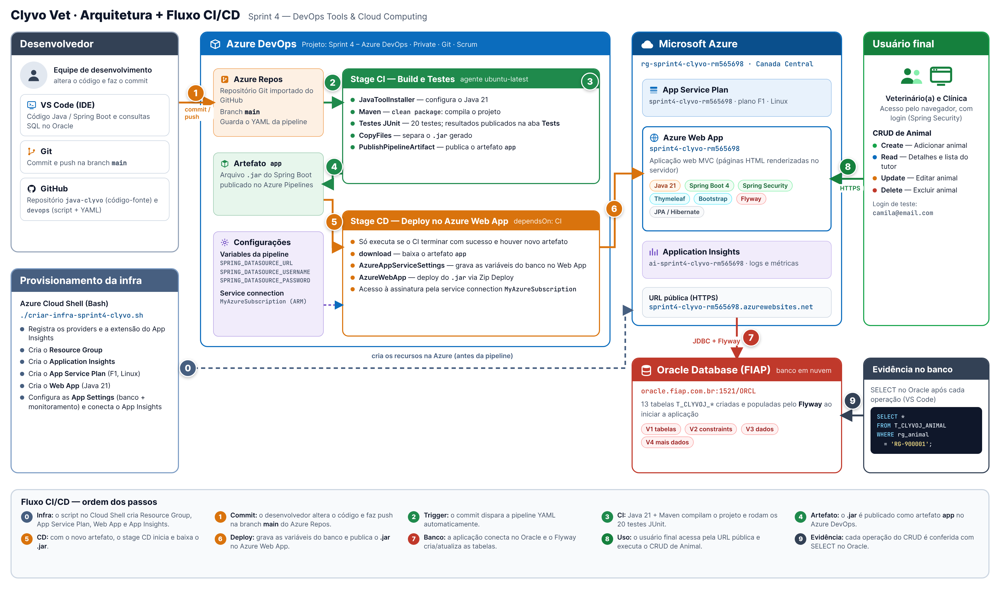

# Clyvo Vet — Sprint 4: DevOps Tools & Cloud Computing

> Sistema de gestão veterinária para acompanhamento contínuo da saúde de
> animais. Aplicação web **Java / Spring Boot (Thymeleaf)** com banco
> **Oracle em nuvem**, entregue por uma esteira de **CI/CD no Azure DevOps**
> que compila, testa e publica automaticamente a aplicação em um
> **Azure Web App** a cada alteração na branch principal.

---

## Índice

- [Sobre o Projeto](#sobre-o-projeto)
- [Benefícios para o Negócio](#benefícios-para-o-negócio)
- [Descrição da Solução e Stack](#descrição-da-solução-e-stack)
- [Arquitetura + Fluxo CI/CD](#arquitetura--fluxo-cicd)
- [Repositórios do Projeto](#repositórios-do-projeto)
- [Banco de Dados em Nuvem](#banco-de-dados-em-nuvem)
- [Projeto no Azure DevOps](#projeto-no-azure-devops)
- [Pipeline CI/CD (azure-pipelines.yml)](#pipeline-cicd-azure-pipelinesyml)
- [Testes Automatizados](#testes-automatizados)
- [Pré-requisitos](#pré-requisitos)
- [Instalação (How-To)](#instalação-how-to)
- [Testando o CRUD](#testando-o-crud)
- [Demonstração do CI/CD (vídeo)](#demonstração-do-cicd-vídeo)
- [Segurança](#segurança)
- [Limpeza dos recursos](#limpeza-dos-recursos)
- [Equipe](#equipe)

---

## Sobre o Projeto

O objetivo da Clyvo é acompanhar a jornada contínua de saúde dos animais,
que sofre com a falta de recorrência nos check-ups. Como os animais não
conseguem comunicar o que estão sentindo, é comum que só sejam levados ao
veterinário quando já estão realmente mal, o que, sem um histórico de saúde
estruturado, pode resultar em diagnósticos tardios.

A Clyvo Vet centraliza em um único lugar o que o veterinário e a clínica
precisam no dia a dia para acompanhar seus pacientes: cadastro de animais e
tutores, consultas, carteira de vacinação, prescrições e histórico do animal.

**Nesta Sprint**, o foco é a prática de **DevOps**: a aplicação passa a ser
entregue por uma esteira automatizada no **Azure DevOps**. A cada commit na
branch `main`:

1. o **CI** compila o projeto, executa os **testes automatizados (JUnit)** e
   publica o **artefato** (`.jar`);
2. o **CD** pega esse novo artefato e faz o **deploy automático** no
   **Azure Web App**, configurando as variáveis de conexão com o banco.

---

## Benefícios para o Negócio

| Benefício | Descrição |
|---|---|
| **Centralização de dados** | Reúne tudo que clínica e veterinário precisam em um só sistema, eliminando a necessidade de vários dispositivos |
| **Diagnóstico mais precoce** | Histórico estruturado de saúde reduz o risco de diagnósticos tardios |
| **Controle vacinal** | Status de vacinação (efetuada, pendente, atrasada, cancelada) sempre visível |
| **Agilidade no atendimento** | O veterinário acessa o histórico completo do animal em segundos |
| **Hardware de baixo custo** | Utiliza ESP32 e sensores de baixo custo, o que barateia a adoção em escala e acelera o efeito de rede entre clínicas parceiras |
| **Monitoramento contínuo e não invasivo** | Sensores de comida, água e movimento captam sinais do dia a dia do pet sem exigir nenhuma ação do tutor |
| **Detecção antecipada de risco à saúde** | A IA identifica padrões de risco (peso, consumo, movimento, predisposição por raça/idade) antes que o problema se torne visível |
| **Personalização real por perfil do animal** | Alertas personalizados por raça, idade e peso. O sistema não usa um padrão genérico, e sim o que é esperado para aquele animal específico |
| **Redução de consultas emergenciais** | Ao sinalizar a existência de riscos antecipadamente, favorece consultas preventivas em vez de atendimentos de urgência, mais caros e estressantes para o pet |
| **Vigilância epidemiológica própria** | A Clyvo constrói sua própria base de dados de casos por região, sem depender de dados públicos de vigilância (escassos e demorados para saúde animal no Brasil) |
| **Alertas regionais em tempo real** | Clínicas/veterinários e tutores de uma mesma área são avisados rapidamente sobre aumento de casos de determinada doença, permitindo resposta mais rápida que a de fontes públicas |
| **Efeito de rede** | Quanto mais clínicas/veterinários parceiros usam o Clyvo, mais dados alimentam o sistema de vigilância regional, tornando o produto cada vez mais valioso |
| **Retenção e diferenciação competitiva** | Clínicas/veterinários parceiros oferecem um serviço de monitoramento contínuo que a concorrência sem o Clyvo não consegue replicar, fortalecendo a fidelização do tutor |
| **Apoio à decisão, não substituição do profissional** | O sistema sinaliza necessidade de atenção em determinados casos, mas mantém o veterinário como responsável pela decisão clínica final |

---

## Descrição da Solução e Stack

**O que a aplicação faz:** é um sistema web para clínicas e veterinários.
Após o login, o veterinário vê na página inicial um painel com seus
indicadores (tutores atendidos, pacientes, consultas e próximas consultas) e
a lista de **tutores e seus animais**, podendo **cadastrar, consultar,
editar e excluir animais** (CRUD). A clínica gerencia seus veterinários e
seu perfil.

| Camada | Tecnologia |
|---|---|
| Linguagem | Java 21 |
| Framework | Spring Boot 4 (Spring MVC, Spring Data JPA / Hibernate, Spring Security, Bean Validation) |
| Front-end | Thymeleaf + Bootstrap 5 (páginas HTML renderizadas no servidor) |
| Banco de dados | Oracle Database (servidor da FIAP — banco em nuvem) |
| Migrations | Flyway (criação e carga das tabelas ao iniciar a aplicação) |
| Build | Maven |
| Testes | JUnit 5 + Mockito + Bean Validation |
| Repositório | Azure Repos (importado do GitHub) |
| CI/CD | Azure Pipelines (YAML, multi-stage: CI + CD) |
| Hospedagem | Azure App Service — Web App Linux (Java 21), plano F1 |
| Monitoramento | Azure Application Insights |
| Provisionamento | Azure CLI (script Bash no Azure Cloud Shell) |

---

## Arquitetura + Fluxo CI/CD



| Passo | Onde atua | O que acontece |
|---|---|---|
| **0** | Azure Cloud Shell | O script `criar-infra-sprint4-clyvo.sh` cria o Resource Group, o App Service Plan, o Web App e o Application Insights (executado uma vez, antes da pipeline) |
| **1** | Git / Azure Repos | O desenvolvedor altera o código e faz o commit na branch `main` |
| **2** | Azure Pipelines | O commit dispara a pipeline automaticamente (`trigger` na branch `main`) |
| **3** | Azure Pipelines — Stage CI | Java 21 + Maven compilam o projeto e executam os 20 testes JUnit |
| **4** | Azure Pipelines — Stage CI | O `.jar` é publicado como artefato `app` no Azure DevOps |
| **5** | Azure Pipelines — Stage CD | Com o novo artefato gerado, o stage CD inicia e baixa o `.jar` |
| **6** | Azure Web App | O CD grava as variáveis do banco no Web App e faz o deploy do `.jar` |
| **7** | Oracle (FIAP) | A aplicação conecta no Oracle e o Flyway cria/atualiza as tabelas |
| **8** | Navegador | O usuário final (veterinário/clínica) acessa a URL pública e usa o sistema |
| **9** | VS Code + Oracle | Cada operação do CRUD é conferida com `SELECT` direto no banco |

---

## Repositórios do Projeto

| Repositório | Conteúdo |
|---|---|
| [`java-clyvo`](https://github.com/ClyvoVet-Challenge-org/java-clyvo) | Código-fonte da aplicação Java / Spring Boot, migrations do Flyway e testes |
| [`devops-sprint4-clyvo`](https://github.com/ClyvoVet-Challenge-org/devops-sprint4-clyvo) | Este repositório: script de infraestrutura, YAML da pipeline, diagrama e How-To |

---

## Banco de Dados em Nuvem

- **Banco:** Oracle Database da FIAP — `oracle.fiap.com.br:1521/ORCL`
  (opção aceita no requisito: "Oracle da FIAP").
- **Criação das tabelas:** feita pelo **Flyway** automaticamente quando a
  aplicação inicia. Não é necessário rodar nenhum script SQL manualmente.
- **Tabelas:** 13 tabelas com prefixo `T_CLYVOJ_` + a tabela de controle
  do Flyway `FLYWAY_HISTORY_CLYVOJ`.

| Migration | Conteúdo |
|---|---|
| `V1__criacao_tabelas.sql` | Criação das 13 tabelas (IDs com `GENERATED BY DEFAULT AS IDENTITY`) |
| `V2__criacao_constraints.sql` | Chaves únicas e estrangeiras |
| `V3__insercao_dados.sql` | Dados iniciais (clínicas, veterinários, usuários, tutores, animais, consultas) |
| `V4__mais_dados_exemplo.sql` | Mais tutores, animais, consultas e vacinas para a demonstração |

---

## Projeto no Azure DevOps

| Campo | Valor |
|---|---|
| **Project name** | Sprint 4 – Azure DevOps |
| **Description** | Projeto para entrega da Sprint 4 do professor João Menk — integrantes abaixo |
| **Visibility** | Private |
| **Version control** | Git |
| **Work item process** | Scrum |

Integrantes informados na descrição do projeto:

```
RM561713 - Eduardo Batista Locaspi - 2TDSPI
RM561833 - Victor Alves Lopes - 2TDSPI
RM565698 - Liana Lyumi Morisita Fujisima - 2TDSPI
RM565799 - Letícia Santiago e Silva - 2TDSPW
```

O professor foi convidado para o projeto com nível de acesso **Basic**.

---

## Pipeline CI/CD (azure-pipelines.yml)

A pipeline é **YAML multi-stage** e fica no arquivo
[`azure-pipelines.yml`](azure-pipelines.yml).

### Gatilho (CI automático)
```yaml
trigger:
  branches:
    include:
      - main
```
Todo commit na branch `main` dispara a pipeline automaticamente.

### Stage CI — Build e Testes
| Task | O que faz |
|---|---|
| `JavaToolInstaller@0` | Configura o Java 21 no agente `ubuntu-latest` |
| `Maven@4` (`clean package`) | Compila o projeto e executa os testes JUnit; publica os resultados na aba **Tests** (`publishJUnitResults: true`) |
| `CopyFiles@2` | Copia o `.jar` gerado em `target/` para a pasta de staging |
| `PublishPipelineArtifact@1` | Publica o artefato **`app`** no Azure DevOps |

### Stage CD — Deploy no Azure Web App
| Configuração / Task | O que faz |
|---|---|
| `dependsOn: CI` + `condition: succeeded()` | O CD só roda depois que o CI termina com sucesso e gera um novo artefato |
| `deployment` + `environment` | Registra o deploy em um *Environment* do Azure DevOps |
| `download: current` | Baixa o artefato `app` gerado pelo CI desta execução |
| `AzureAppServiceSettings@1` | Grava no Web App as variáveis `SPRING_DATASOURCE_USERNAME`, `SPRING_DATASOURCE_PASSWORD` e `SPRING_DATASOURCE_URL` |
| `AzureWebApp@1` (`zipDeploy`) | Faz o deploy do `.jar` no Web App Linux |

### Variáveis da pipeline
Cadastradas em **Pipelines → Edit → Variables**:

| Nome | Valor |
|---|---|
| `SPRING_DATASOURCE_USERNAME` | usuário do Oracle (RM) |
| `SPRING_DATASOURCE_PASSWORD` | senha do Oracle |
| `SPRING_DATASOURCE_URL` | `jdbc:oracle:thin:@//oracle.fiap.com.br:1521/ORCL` |

> Por orientação do professor, as variáveis foram cadastradas **sem** a
> opção *Keep this value secret*. Assim, elas também ficam disponíveis como
> variáveis de ambiente para o Maven durante os testes do CI (o teste
> `contextLoads` sobe a aplicação conectando no Oracle).

### Service connection
`MyAzureSubscription` — conexão do tipo **Azure Resource Manager**, com
escopo na assinatura e no Resource Group `rg-sprint4-clyvo-rm565698`. É ela
que dá permissão para a pipeline configurar e publicar no Web App.

---

## Testes Automatizados

São **20 testes JUnit**, executados no stage CI e publicados na aba
**Tests** da execução da pipeline.

| Classe | Qtd | O que valida |
|---|---|---|
| `ClyvoChallenge3ApplicationTests` | 1 | `contextLoads`: a aplicação sobe por completo (Spring, Security, JPA, Flyway e conexão com o Oracle) |
| `AnimalValidacaoTest` | 6 | Animal válido; nome obrigatório; nascimento não pode ser futuro; peso maior que zero; limite de dígitos do peso; responsável obrigatório |
| `MedicamentoValidacaoTest` | 4 | Medicamento válido; dose maior que zero; dias de tratamento ≥ 1; forma farmacêutica obrigatória |
| `VeterinarioValidacaoTest` | 3 | Formato do CRMV (ex.: `SP1234`); CRMV inválido; e-mail inválido |
| `AcessoServiceTest` | 6 | Regra de acesso: o veterinário só vê tutores/animais que já atendeu; usuário inexistente ou de clínica é bloqueado (repositórios simulados com Mockito) |

---

## Pré-requisitos

- Conta ativa no **Microsoft Azure** (assinatura de estudante)
- Acesso ao **Azure Cloud Shell**
- Organização no **Azure DevOps** (`https://dev.azure.com/{sua-organizacao}`)
- Usuário e senha do **Oracle da FIAP**
- Ferramenta para consultar o banco (ex.: **VS Code** com a extensão
  *Oracle SQL Developer*)

---

## Instalação (How-To)

### 1. Clonar este repositório (no Azure Cloud Shell)

Abra o **Cloud Shell** no Portal da Azure (ícone `>_`) no modo **Bash**.

`git clone` — baixa este repositório para o Cloud Shell, trazendo o script `criar-infra-sprint4-clyvo.sh` e o `azure-pipelines.yml`
```bash
git clone https://github.com/ClyvoVet-Challenge-org/devops-sprint4-clyvo.git
```

`cd` — entra na pasta clonada, de onde os próximos comandos serão executados
```bash
cd devops-sprint4-clyvo
```

### 2. Conferir a assinatura da Azure

`az account show` — exibe a assinatura ativa, para confirmar que os recursos serão criados na assinatura correta
```bash
az account show
```

Caso precise trocar de assinatura:
```bash
az account list -o table
az account set --subscription "nome-da-assinatura-correta"
```

### 3. Revisar as variáveis do script

`nano` — abre o script para conferir RM, usuário, senha do Oracle e região
```bash
nano criar-infra-sprint4-clyvo.sh
```

| Variável | Valor | Para que serve |
|---|---|---|
| `RESOURCE_GROUP_NAME` | `rg-sprint4-clyvo-rm565698` | Grupo que reúne todos os recursos do projeto |
| `WEBAPP_NAME` | `sprint4-clyvo-rm565698` | Nome do Web App (vira a URL `https://sprint4-clyvo-rm565698.azurewebsites.net`) |
| `APP_SERVICE_PLAN` | `sprint4-clyvo-rm565698` | Plano de hospedagem do Web App |
| `LOCATION` | `canadacentral` | Região dos recursos |
| `RUNTIME` | `JAVA:21-java21` | Runtime do Web App (mesma versão do projeto) |
| `APP_INSIGHTS_NAME` | `ai-sprint4-clyvo-rm565698` | Application Insights para logs e métricas |
| `USERNAME` / `PASSWORD` / `URL` | dados do Oracle da FIAP | Variáveis de conexão gravadas no Web App |

Para salvar e sair do `nano`: **Ctrl+O**, **Enter**, **Ctrl+X**.

### 4. Criar a infraestrutura

`chmod +x` — concede permissão de execução ao script
```bash
chmod +x criar-infra-sprint4-clyvo.sh
```

`./criar-infra-sprint4-clyvo.sh` — executa o script, que:
- registra os providers `Microsoft.Web`, `Microsoft.Insights`, `Microsoft.OperationalInsights` e `Microsoft.ServiceLinker`;
- adiciona a extensão `application-insights` ao Azure CLI;
- cria o **Resource Group** (`az group create`);
- cria o **Application Insights** (`az monitor app-insights component create`);
- cria o **App Service Plan** F1 Linux (`az appservice plan create`);
- cria o **Web App** com Java 21 (`az webapp create`);
- grava as **App Settings** do Web App: conexão do Application Insights e as variáveis `SPRING_DATASOURCE_*` (`az webapp config appsettings set`);
- reinicia o Web App e o conecta ao Application Insights.
```bash
./criar-infra-sprint4-clyvo.sh
```

### 5. Conferir os recursos criados

`az resource list` — lista os recursos do Resource Group
```bash
az resource list --resource-group rg-sprint4-clyvo-rm565698 --output table
```

`az webapp config show` — confirma que o Web App está com Java 21 (deve retornar `"JAVA|21-java21"`)
```bash
az webapp config show --name sprint4-clyvo-rm565698 --resource-group rg-sprint4-clyvo-rm565698 --query linuxFxVersion
```

> Neste ponto o Web App ainda não tem a aplicação: o código chega pela
> pipeline de CD nos próximos passos.

### 6. Configurar a organização no Azure DevOps

Em `https://dev.azure.com/{sua-organizacao}`:

1. **Organization settings → Pipelines → Settings**
2. Deixe **desligadas** as opções *Disable creation of classic build
   pipelines* e *Disable creation of classic release pipelines*.

### 7. Criar o projeto

**New project**, com os dados da seção [Projeto no Azure DevOps](#projeto-no-azure-devops)
(nome, descrição com o professor e os integrantes, *Private*, *Git*, *Scrum*).

### 8. Importar o repositório da aplicação

1. **Repos → Import a repository → Import**
2. **Clone URL:** `https://github.com/ClyvoVet-Challenge-org/java-clyvo.git`
3. Como o repositório é privado, marque **Requires Authentication** e informe
   o usuário do GitHub e um **Personal Access Token** (escopo `repo`).
4. Clique em **Import** e confira em **Repos → Files** os arquivos e a
   branch `main`.

### 9. Criar a Service Connection

1. **Project settings → Pipelines → Service connections → Create service connection**
2. Tipo **Azure Resource Manager** → **Next**
3. Preencha:
   - **Identity type / Credential:** manter o padrão
   - **Scope level:** Subscription
   - **Subscription:** a sua assinatura
   - **Resource group:** `rg-sprint4-clyvo-rm565698`
   - **Service Connection Name:** `MyAzureSubscription` (mesmo nome usado no YAML)
   - **Description:** `Credenciais para minha assinatura da Azure`
   - Marque **Grant access permission to all pipelines**
4. **Save**

### 10. Criar a pipeline YAML

1. **Pipelines → Create Pipeline**
2. **Azure Repos Git (YAML)** → selecione o repositório **Sprint 4 – Azure DevOps**
3. **Starter pipeline**
4. Apague o conteúdo de exemplo e cole o conteúdo de [`azure-pipelines.yml`](azure-pipelines.yml)
5. **Variables → New variable** e cadastre `SPRING_DATASOURCE_USERNAME`,
   `SPRING_DATASOURCE_PASSWORD` e `SPRING_DATASOURCE_URL`
   (ver [Variáveis da pipeline](#variáveis-da-pipeline)) → **Save**

### 11. Executar a pipeline pela primeira vez

1. **Save and run**
2. **Commit message:** `Criação da Pipeline YAML`
3. Marque **Commit directly to the main branch** → **Save and run**
4. O **Stage CI** executa (build, testes e artefato).
5. Na primeira execução, o **Stage CD** fica em *Waiting — Permission
   needed*: clique em **View → Permit → Permit** para autorizar o acesso ao
   Environment e à Service Connection. Isso só é necessário na primeira vez.
6. O **Stage CD** faz o deploy no Web App.

### 12. Conferir o resultado da pipeline

- **Summary:** stages CI e CD em verde, *1 published* (artefato) e
  *100% tests passed*
- **Tests:** 20 testes, 100% aprovados (remova o filtro *Aborted* e
  selecione *Passed* para ver a lista com os nomes dos testes)
- **Artefato:** em *Related → 1 published*, o artefato `app` com o `.jar`
- **Jobs:** cada task do CI e do CD com seu log de execução

### 13. Acessar a aplicação

Após o deploy, aguarde de 1 a 2 minutos (o plano gratuito leva esse tempo
para iniciar o Spring Boot) e acesse:

```
https://sprint4-clyvo-rm565698.azurewebsites.net
```

| Perfil | Login | Senha |
|---|---|---|
| Veterinária | `camila@email.com` | `senha123` |
| Clínica | `contato@amigofiel.com` | `senha123` |

Na primeira subida, o Flyway cria as tabelas no Oracle. Para conferir:
```sql
SELECT table_name FROM user_tables WHERE table_name LIKE 'T_CLYVOJ%';
```

### 14. CI/CD automático

A partir daqui, **qualquer commit na branch `main`** (pelo VS Code com
`git push` ou editando o arquivo em **Repos → Files → Edit → Commit**)
dispara a pipeline sozinha: CI → artefato → CD → Web App atualizado.

---

## Testando o CRUD

> O CRUD é feito pela interface da aplicação, logado como a veterinária
> **Dra. Camila Torres** (`camila@email.com` / `senha123`). Na página inicial
> aparecem os tutores que ela atende, com os animais de cada um e os botões
> **+ Adicionar animal**, **Detalhes**, **Editar** e **Excluir**.
>
> A **evidência de persistência** de cada operação é feita com `SELECT`
> direto no Oracle (VS Code + extensão Oracle SQL Developer).
>
> **Regra de negócio:** animais que já possuem consultas não podem ser
> excluídos (o histórico clínico é preservado). O teste de exclusão é feito
> com o animal cadastrado no próprio teste.

### CREATE — Inserir um animal

Na página inicial, no card da tutora **Beatriz Almeida**, clique em
**+ Adicionar animal** e preencha:

| Campo | Valor |
|---|---|
| Nome | `Thor` |
| Data de nascimento | `10/05/2022` |
| Peso | `12` |
| Espécie | `Canina` |
| Raça | `Labrador` |
| RG | `RG-900001` |
| País / Estado / Cidade | `Brasil` / `SP` / `Sao Paulo` |
| Bairro / Logradouro / Número | `Pinheiros` / `Rua dos Pinheiros` / `320` |
| Complemento / CEP | `Casa 2` / `05422-001` |

Clique em **Salvar**: a aplicação abre a ficha do animal.

**SELECT no banco**
```sql
SELECT id_animal, nm_animal, especie_animal, raca_animal, peso_animal, rg_animal
FROM T_CLYVOJ_ANIMAL
WHERE rg_animal = 'RG-900001';
```

### READ — Consultar

Na ficha do animal, clique no nome da responsável (**Beatriz Almeida**):
a página dela lista todos os seus animais, incluindo o **Thor**. Clique em
**Detalhes** para voltar à ficha.

**SELECT no banco** — animais da tutora, com o nome do responsável
```sql
SELECT a.id_animal, a.nm_animal, a.especie_animal, a.raca_animal, a.peso_animal,
       r.nm_responsavel
FROM T_CLYVOJ_ANIMAL a
JOIN T_CLYVOJ_RESPONSAVEL r ON r.id_responsavel = a.id_responsavel
WHERE r.nm_responsavel = 'Beatriz Almeida';
```

### UPDATE — Atualizar

Na ficha do Thor, clique em **Editar**, altere **Peso** para `14` e **Raça**
para `Labrador Retriever` e salve. Confira a alteração na ficha e na página
da responsável.

**SELECT no banco**
```sql
SELECT id_animal, nm_animal, raca_animal, peso_animal
FROM T_CLYVOJ_ANIMAL
WHERE rg_animal = 'RG-900001';
```

### DELETE — Excluir

Na ficha do Thor (ou na linha dele na página inicial), clique em
**Excluir** e confirme. A aplicação exibe *"Animal excluído com sucesso"* e
o Thor some da lista da tutora. O endereço do animal é removido junto.

**SELECT no banco** (deve retornar *no rows selected*)
```sql
SELECT id_animal, nm_animal
FROM T_CLYVOJ_ANIMAL
WHERE rg_animal = 'RG-900001';
```

---

## Demonstração do CI/CD (vídeo)

[Assistir à demonstração no YouTube](COLOQUE-AQUI-O-LINK-DO-VIDEO)

Roteiro demonstrado:
1. Ferramentas utilizadas (VS Code, Azure DevOps, Portal da Azure, Oracle)
2. Configuração da pipeline (stages, jobs, tasks e variáveis)
3. Alteração visual no código e commit na branch `main`
4. Início automático da pipeline e explicação de cada etapa nos logs
5. Artefato publicado e resultados dos testes
6. Recursos no Portal da Azure atualizados pelo deploy
7. Aplicação no Web App com a alteração
8. CRUD completo com `SELECT` no banco a cada operação

---

## Segurança

- **Autenticação e autorização:** o acesso à aplicação exige login (Spring
  Security). Cada perfil só acessa suas áreas: rotas `/clinica/**` para
  clínicas e `/vet/**`, `/animais/**`, `/responsaveis/**` para veterinários.
- **Senhas dos usuários:** armazenadas no banco com hash **BCrypt**, nunca
  em texto puro.
- **Regra de acesso a dados:** o veterinário só visualiza, edita ou exclui
  animais e tutores que já atendeu em alguma consulta (`AcessoService`,
  coberto por testes automatizados).
- **HTTPS:** a aplicação é acessada pelo domínio `azurewebsites.net`, com
  HTTPS fornecido pelo Azure App Service.
- **Credenciais do banco:** ficam fora do código-fonte da aplicação — são
  lidas de variáveis de ambiente (`SPRING_DATASOURCE_*`), gravadas no Web App
  pela pipeline a partir das *Variables* do Azure DevOps. Por orientação do
  professor, nesta entrega as variáveis não foram marcadas como secretas.
- **Acesso à Azure pela pipeline:** feito pela Service Connection
  `MyAzureSubscription` (Workload Identity Federation), sem senha ou chave
  armazenada no YAML.

---

## Limpeza dos recursos

`az group delete` — remove o Resource Group inteiro (Web App, App Service
Plan e Application Insights), evitando custos após a avaliação
```bash
az group delete --name rg-sprint4-clyvo-rm565698 --yes --no-wait
```

`rm -rf` — remove a pasta deste repositório do Cloud Shell
```bash
rm -rf devops-sprint4-clyvo
```

---

## Equipe

| RM | Nome | Turma |
|---|---|---|
| RM561713 | Eduardo Batista Locaspi | 2TDSPI |
| RM565799 | Letícia Santiago e Silva | 2TDSPW |
| RM565698 | Liana Lyumi Morisita Fujisima | 2TDSPI |
| RM561833 | Victor Alves Lopes | 2TDSPI |
